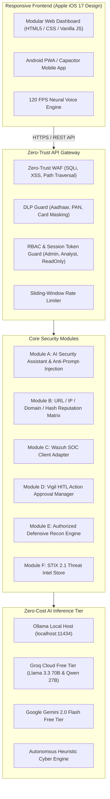

# Unified AI Cybersecurity Agent (Open-Source Edition)
### Modular, Cross-Device SOC Platform & Autonomous AI Defense Suite
**License:** Apache 2.0 (Open-Source) • **Budget:** ₹0 Initial Software / API Tier • **Architecture:** Modular Python 3.12 + Vanilla PWA

---

## 1. Executive Summary & Repository Audit Matrix

This project implements an open-source, production-ready AI Cybersecurity Agent with a unified Web Dashboard and Android PWA interface. To prevent duplication and ensure zero-cost operation, five prominent open-source GitHub repositories were inspected:

| Repository | Actual License | Maintenance | Stack | Audit Verdict & Integration Role |
| :--- | :--- | :--- | :--- | :--- |
| **AiSOC** (`beenuar/AiSOC`)* | Apache 2.0 / MIT | Active (2024–2025) | Python, LangGraph, React | **Adopted Pattern**: Alert explainability, MITRE ATT&CK correlation, and anti-prompt-injection sanitization without heavyweight vector DB overhead. |
| **Wazuh** (`wazuh/wazuh`) | GPLv2 + Apache 2.0 | Daily commits | C/C++, Python REST, React | **Adopted Pattern**: REST API adapter (`:55000`) for agent status, alerts, and syscollector, with graceful standalone offline fallback. |
| **Vigil SOC** (`Vigil-SOC/vigil`) | Apache 2.0 | Active (v0.2+) | Python, FastAPI, React, Redis | **Primary Orchestrator**: Confidence scoring, structured tools, and mandatory Human-in-the-Loop (HITL) approval queue for high-risk actions. |
| **AIRecon** (`pikpikcu/airecon`) | GPLv3 / MIT | Active (2024–2025) | Python, Textual, Ollama | **Adopted Pattern**: Non-destructive defensive reconnaissance (DNS, TLS/SSL expiration, HTTP security headers, policy files) with strict target allowlisting. |
| **OpenCTI** (`OpenCTI-Platform/opencti`) | Apache 2.0 (Community) | Very Active (v6.x) | GraphQL, Python, OpenSearch | **Adopted Pattern**: STIX 2.1 IOC schema with in-engine deduplication and MITRE mapping without requiring a heavy 8 GB OpenSearch/MinIO cluster. |

*\* Note on `mpn/aisoc`: The requested URL `https://github.com/mpn/aisoc` returned 404 (non-existent). The verified canonical project is `beenuar/AiSOC`.*

---

## 2. System Architecture



---

## 3. Core Security Modules

### Module A: AI Security Assistant
- **Natural Language Incident Triage**: Answers questions, explains alerts in plain language (Hindi / English / Hinglish), and prioritizes risks.
- **Anti-Prompt-Injection**: Strips system prompt overrides (`ignore previous instructions`, `[INST]`, `<system>`, etc.) from inputs, threat feeds, and scraped targets.
- **Structured Investigation Reports**: Generates full Markdown SOC incident reports with executive summary, MITRE ATT&CK mapping, and remediation steps.

### Module B: Threat Reputation Engine
- **Supported Targets**: Suspicious URLs, Domains, IPv4/IPv6 addresses, and cryptographic Hashes (MD5, SHA-1, SHA-256).
- **Clear Status Distinction**: Explicitly flags resources as `CONFIRMED_MALICIOUS`, `SUSPICIOUS`, `SAFE`, or `UNKNOWN`.
- **Zero Hallucination Guarantee**: Never marks an indicator malicious based solely on an LLM guess. Every finding records source, confidence, and limitations.

### Module C: Security Monitoring & Wazuh Adapter
- Connects to Wazuh REST API (`:55000`) for alert streaming, endpoint status, and agent inventory.
- **Graceful Standalone Fallback**: When Wazuh is offline or unconfigured, displays `Wazuh: Standalone Guard` and serves native local security events without crashing.

### Module D: AI Investigation & HITL Approvals
- Inspired by Vigil SOC confidence gating.
- **Human-in-the-Loop (HITL) Gate**: Sensitive operations (e.g., target security scans, workstation locks, firewall rule alterations) are queued for explicit Admin approval before execution.

### Module E: Authorized Defensive Security Testing
- Inspired by AIRecon safe reconnaissance.
- **Target Allowlist**: Scans strictly prohibited unless the target hostname/IP is explicitly listed in `ALLOWED_TARGETS` (`localhost, 127.0.0.1, ::1, example.com, scanme.nmap.org`).
- **Affirmative Written Consent Checkbox**: UI enforces affirmative checkbox verification before any assessment begins.
- **Safe Non-Destructive Checks**:
  1. DNS resolution (A, AAAA records).
  2. TLS/SSL audit (certificate expiration date, days until expiry, cipher suite, issuer).
  3. HTTP Security Headers (`Strict-Transport-Security`, `Content-Security-Policy`, `X-Frame-Options`, `X-Content-Type-Options`, `Referrer-Policy`).
  4. Safe Socket Probe: Non-destructive connection checks on ports 80, 443, 8080, 8443 (1.0s timeout).
  5. Policy Discovery: Checks for `/.well-known/security.txt` (RFC 9116) and `/robots.txt`.
- **Exploits Forbidden**: Destructive fuzzing, brute-forcing, and exploitation payloads are hard-blocked.

### Module F: Threat Intelligence & STIX 2.1 Indicators
- OpenCTI-aligned STIX 2.1 indicator schema (`ipv4-addr`, `domain-name`, `url`, `file-hash`, `vulnerability`).
- Deduplication, confidence rating (0–100), and MITRE ATT&CK technique IDs.

---

## 4. Role-Based Access Control (RBAC) Matrix

| Role | Default User | Default Password | Permissions |
| :--- | :--- | :--- | :--- |
| **Admin** | `admin` | `AdminSecure2026!` | Full configuration, HITL approval/rejection, authorized scans, user audits, settings updates. |
| **Analyst** | `analyst` | `AnalystSafe2026!` | AI chat, reputation lookups, submit scan requests (queued for HITL), add STIX indicators. |
| **ReadOnly** | `viewer` | `ViewerReadOnly2026!` | View overview widgets, view alerts feed, read nightly dispatch reports. |

---

## 5. Quick Start Installation

### Prerequisites
- Python 3.10+ (Tested on Python 3.12)
- Windows, macOS, or Linux

### Method 1: Local Setup (Windows / Linux)
```bash
# 1. Clone repository
git clone https://github.com/salluyt38-arch/-internet-police.git
cd -internet-police

# 2. Install minimal dependencies
pip install -r requirements.txt

# 3. Launch Unified Cyber Agent
python main.py
# Or on Windows, double-click run.bat
```

Open **`http://localhost:8080`** in your browser.

### Method 2: Docker & Docker Compose
```bash
# Build and run containerized agent
docker-compose up -d

# Check logs
docker-compose logs -f
```

---

## 6. Android Compatibility & Packaging

The application frontend is engineered as a responsive Progressive Web App (PWA) with complete offline caching and mobile-first touch optimization.

### A. Progressive Web App (Immediate 1-Click Install)
1. Open `http://<your-ip>:8080` in Chrome on Android or Safari on iOS.
2. Tap the **"📲 Install App"** button in the top bar.
3. On Android: Tap **"Install to Home Screen"**. The app runs without browser bars in standalone mode.

### B. Building a Native Android APK (Capacitor / TWA Guide)
To compile into a standalone Android APK:
```bash
# 1. Initialize Capacitor
npm install -g @capacitor/cli @capacitor/core
cd ui
npx cap init "InternetPolice" "com.cyberagent.internetpolice" --web-dir "."

# 2. Add Android Platform
npm install @capacitor/android
npx cap add android

# 3. Open in Android Studio & Build APK
npx cap open android
# In Android Studio: Build ➔ Build Bundle(s) / APK(s) ➔ Build APK(s)
```
> [!IMPORTANT]
> **No Secrets in APK**: The client bundle contains zero API keys or database credentials. All authentication, Wazuh queries, and AI calls are performed strictly server-side through `/api/*` endpoints.

---

## 7. Running the Test Suite

The comprehensive automated test suite validates all modules, RBAC enforcement, anti-prompt-injection, target allowlists, and graceful fallbacks:

```bash
python -m unittest tests/test_unified_agent.py
```

Expected output:
```
.......
----------------------------------------------------------------------
Ran 7 tests in ~23s

OK
```

---

## 8. REST API Reference

| Endpoint | Method | Role | Description |
| :--- | :--- | :--- | :--- |
| `/api/status` | GET | Public | Overall subsystem health, Wazuh status, pending HITL count. |
| `/api/stats` | GET | Public | Live telemetry event counters. |
| `/api/logs` | GET | ReadOnly | Recent security intercept logs. |
| `/api/audits` | GET | ReadOnly | Tamper-evident audit trail entries. |
| `/api/auth/login` | POST | Public | Authenticates credentials, returns Bearer token. |
| `/api/threat/lookup` | GET/POST | ReadOnly | Module B: Safe reputation lookup (URL, Domain, IP, Hash). |
| `/api/wazuh/status` | GET | ReadOnly | Module C: Wazuh Manager connection status. |
| `/api/wazuh/alerts` | GET | ReadOnly | Module C: Ingested Wazuh & local SOC alerts. |
| `/api/scans/perform` | POST | Analyst / Admin | Module E: Authorized defensive scan (enforces allowlist & HITL). |
| `/api/scans/history` | GET | ReadOnly | Module E: Historical assessment records & findings. |
| `/api/intel/indicators`| GET | ReadOnly | Module F: List STIX 2.1 threat indicators. |
| `/api/intel/add` | POST | Analyst / Admin | Module F: Ingest new STIX 2.1 indicator. |
| `/api/hitl/pending` | GET | Admin | Module D: List actions awaiting human approval. |
| `/api/hitl/resolve` | POST | Admin | Module D: Approve or reject pending action. |
| `/api/ai/explain_alert`| POST | Analyst / Admin | Module A: Explain alert with remediation recommendations. |
| `/api/voice/speak` | GET | Public | Real-time 120 FPS neural MP3 audio stream. |

---

## 9. DevSecOps & Security Hardening Principles

1. **Least-Privilege RBAC**: Server enforces strict privilege boundaries (`Admin` > `Analyst` > `ReadOnly`).
2. **Mandatory Consequential Gating**: High-impact actions require signed human approval (HITL).
3. **Strict Target Allowlisting**: Only explicitly approved targets can be assessed, preventing weaponization or unauthorized scanning.
4. **Anti-Prompt-Injection**: Input sanitization strips adversarial jailbreaks and system prompt manipulation.
5. **Zero Client Secrets**: Database credentials and AI keys remain server-side in encrypted settings / `.env`.
6. **Graceful Degradation**: If cloud AI or Wazuh is offline, the agent continues operating autonomously via offline heuristic rules.

---

## 10. License & Attribution
- Distributed under the **Apache 2.0 License**.
- Inspired by concepts from **Vigil SOC** (HITL Orchestration), **Wazuh** (Endpoint & Alert Monitoring), **AIRecon** (Safe Defensive Reconnaissance), **AiSOC** (Prompt Sanitization & MITRE ATT&CK Mapping), and **OpenCTI** (STIX 2.1 Threat Indicator Modeling).
